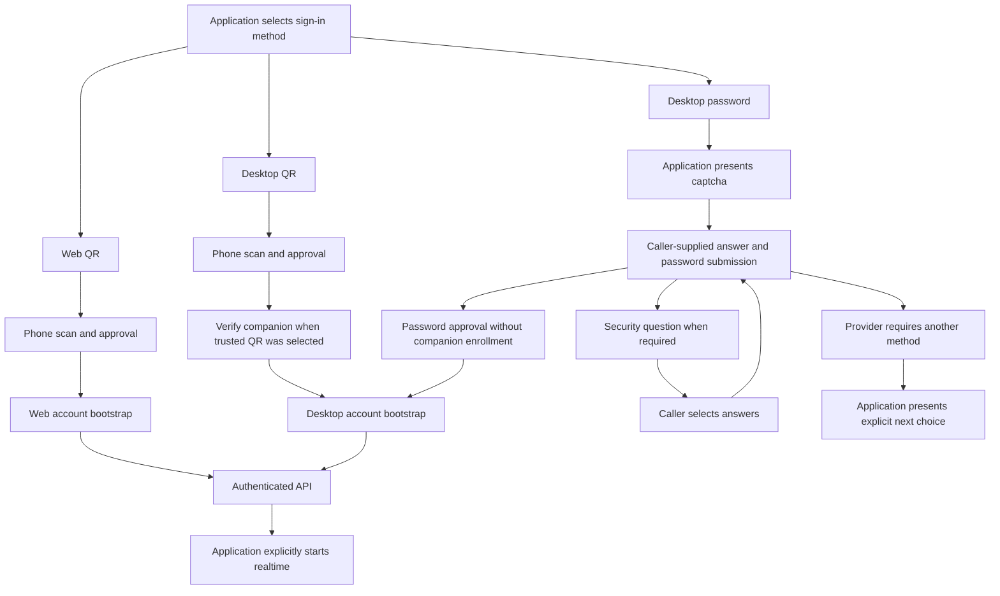

# Authentication and account security

The SDK exposes separate Web and Desktop session formats. Applications own credential entry, challenge presentation and secure storage. The installed app's private account files are not imported.

| Operation | Entry point | Scope |
| --- | --- | --- |
| Web QR sign-in | `PersonalZalo.loginWithQR` | User scans and approves; resolves after Web account bootstrap. |
| Web resume | `PersonalZalo.resume` / `connect` | Fetches fresh account context using an SDK cookie session. |
| Desktop QR sign-in | `loginDesktopWithQR` | Default fresh QR; explicit `retainLinkingSecret` or selected `relink`, current trusted verification, bootstrap and optional coupled persistence. |
| Desktop password sign-in | `loginDesktopWithPassword` | Captcha, explicit password submission, source-traced security-question responses and bootstrap. Password login does not enroll a trusted companion. |
| Explicit password transport | `createDesktopPasswordLoginTransport` | Caller-controlled configuration, captcha and V2 submissions for a custom sign-in screen. |
| Desktop password recovery | `recoverDesktopPassword` / `createDesktopRecoveryTransport` | Explicit phone confirmation, caller-entered OTP/security answers, new password and fresh bootstrap. No automatic code request or recovery replay. |
| Desktop resume | `connectDesktopSession` | Uses an approved Desktop snapshot to fetch fresh keys, service configuration and API context. |
| Desktop renewal | `renewDesktopSession` | Explicit token-pair rotation and atomic application save; retires the old connection. |
| Password presence | `getDesktopPasswordStatus` | Reads a boolean presence flag; returns no password. |
| Password create/change | `changeDesktopPassword` | Explicit current/new/repeated password fields on a live Desktop connection. |
| Two-factor setting | `updateDesktopTwoFactor` | Explicit initial request or caller-owned OTP submission; a request may apply the setting or initiate an SMS/challenge. |
| Provider sign-out | `PersonalZalo.submitWebSignOut` / `signOutDesktopSession` | Separate explicit Web/Desktop requests with their own acknowledgement and storage semantics. |
| Local forget | `clearLocalSession`, CLI `forget` / `desktop-forget` | Deletes local SDK credentials; does not revoke a remote device. |

## Sessions and trust

Web cookie sessions use `FileSessionStore`; Desktop snapshots and verified companions use `FileDesktopSessionStore` or application storage. Desktop secret-absent files stay version 1; explicit retained-secret records use version 2, preventing old readers from silently dropping the secret. Both are owner-only **plaintext**, not encrypted vaults. A snapshot excludes account AES keys and resume fetches fresh context. Explicit relink uses caller-retained state, with private accepted recovery copies and save observations after later failure. These formats remain incompatible. [Retained login and recovery](desktop-relink.md) · [Storage](desktop-session-store.md)

Phone approval, a successful HTTP exchange, an account bootstrap, a realtime key frame and a verified trusted companion are separate evidence. Password login follows the installed client's path without trusted-device enrollment. It does not manufacture a companion, enroll message E2EE, or turn a password success into trusted QR verification. Applications that need trusted pairing must use the explicit pairing flow.

Desktop password, two-factor, renewal and sign-out mutations share the connection's account-operation lock. Normal credentialed transport may update its in-memory cookie jar from provider responses. Password/two-factor helpers do not call application session save/clear callbacks, manually rotate tokens, or independently verify session revocation effects.

## Challenges and uncertain outcomes

Password login presents source-traced captcha and security-question steps to the application. The application supplies the user's answers. Provider requirements for QR, mobile confirmation, OTP or an upgraded app are surfaced; unsupported continuations are not guessed and another sign-in method is not started automatically.

Password recovery is a separate unauthenticated attempt with its own phone, OTP-issued token and AES key. A code request requires explicit confirmation; security answers and the final password require fresh callback actions. An outer protocol-negotiation refusal also requires confirmation before its single plain-mode retry. A successful final reset can have effects even when bootstrap, persistence or cancellation prevents login; `resetAcknowledged` retains that receipt. Certificate-only replies stop without inventing a session or trusted companion. [Recovery contract](desktop-recovery.md)

Two-factor `request` is an account mutation and can cause an SMS or another challenge. It is not a status read. A later `submit` uses a code the user supplies. The SDK does not choose codes, request another code automatically, cache a native UI countdown, or infer the current privacy setting from an error. Private challenge details require explicit access and remain application data.

Known provider acknowledgement and rejection are distinguished from transport/body/cancellation uncertainty. A submitted mutation with an unknown result needs application reconciliation before another explicit attempt. The helpers do not automatically replay it. Provider errors expose fixed SDK messages and safe numeric codes, rather than raw response messages, query strings, passwords, OTPs or token-bearing causes.

## Current verification

Web QR approval, resume and an initial realtime key frame were verified earlier against the live account. On 6 November 2026, the later saved-Web bootstrap returned decrypted provider code 102 with no account data. HTTP 200 and outer provider zero did not prove authentication. That current refusal does not establish a specific expiry or revocation cause.

The initial approved Desktop QR failed before persistence. The server retry-profile schema blocker was fixed in 0.15.0, and the user's fresh QR retry subsequently saved a Desktop session. A separate `desktop-verify` invocation then successfully bootstrapped that session and read the account profile. Read checks accepted the friend/group lists, another profile's rank metadata, a direct board, one group context and account verification status. The saved record contains no companion evidence; this does not establish trusted pairing. A separate user-authorized `desktop-verify --realtime` then received the initial key frame and exited after stopping the feed. This verifies its handshake, not message delivery or all listener events. No password login or account-setting mutation was substituted for the QR retry.

Password login, recovery, password changes and two-factor settings have separate source/fixture evidence in their guides. No live password, security-question answer, OTP/SMS request or security-setting change was submitted during their implementation. Complete live Desktop interoperability and complete installed-operation parity remain unverified.

All 45 controlled SDK 0.43 retention/relink/recovery/store groups pass locally. Native/live retained-login success remains unverified. The saved ordinary Desktop record above has no companion evidence and does not validate this opt-in path.

## Guides and remaining flows

[Web authentication](web-protocol.md), [Desktop QR lifecycle](desktop-login.md), [Desktop bootstrap](desktop-session.md), [password sign-in](desktop-password-login.md), [password recovery](desktop-recovery.md), [password changes](desktop-password.md), [two-factor settings](desktop-two-factor.md), [renewal](desktop-session-renewal.md), [sign-out](desktop-signout.md), [trusted pairing](trusted-device-pairing.md), and [storage](desktop-session-store.md) retain exact contracts and limits.

Registration, standalone phone-number verification, and enterprise/email/Facebook sign-in are not implied by the password or recovery implementations. The installed route inventory includes related builders, but each needs its own current consumer, challenge lifecycle and verification before it can be presented as a complete SDK operation. Caller access to generic `api.custom()` is not proof that those workflows are implemented.
